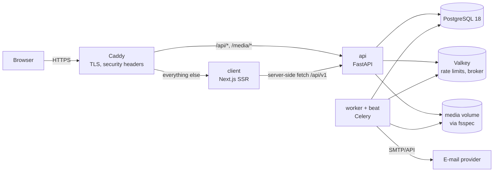
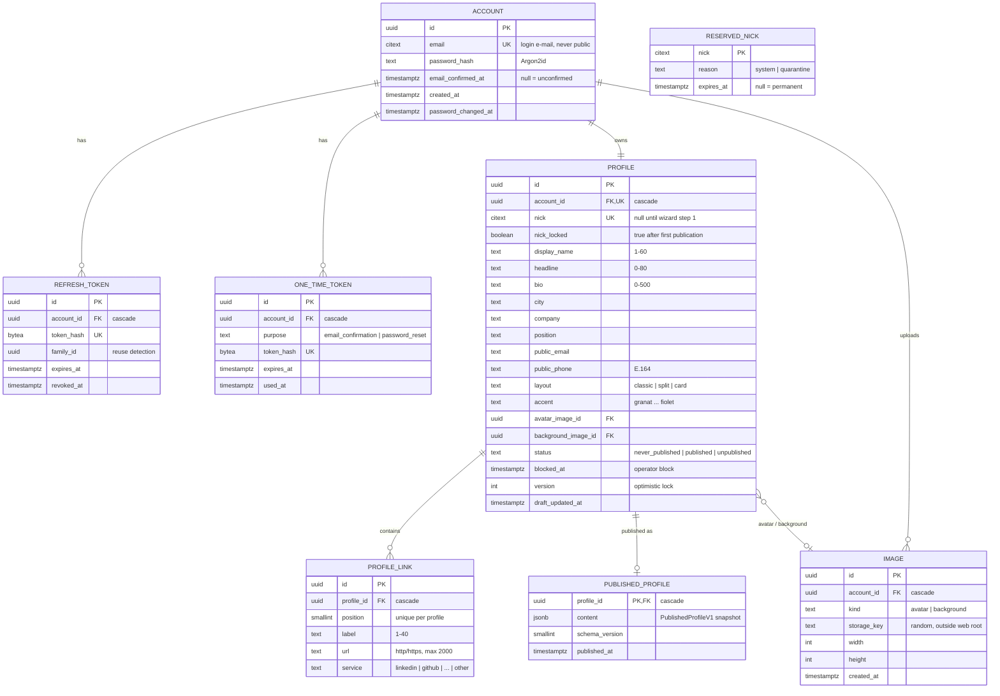

# Architecture

Modular monolith. Product areas: `docs/product/areas/`. Decisions: `docs/decisions/`. API contract: `docs/api/openapi.yaml`.

## Runtime

| Container | Responsibility |
|---|---|
| `caddy` | TLS (Let's Encrypt), HSTS, CSP and other headers, routing, gzip/zstd |
| `client` | Next.js: landing, legal pages, `/user/{nick}` (SSR, no cache), owner panel (client components) |
| `api` | FastAPI `/api/v1/**`, `/media/**`, `/health`, `/ready` |
| `worker` | Celery tasks: e-mails, image processing, cleanup |
| `beat` | Celery Beat schedule (single instance) |
| `db`, `valkey` | PostgreSQL 18, Valkey 9 |

## Backend modules (`api/app/modules/`)

| Module | Product area | Owns tables | Public interface for other modules |
|---|---|---|---|
| `accounts` | Accounts | `accounts`, `refresh_tokens`, `one_time_tokens` | `get_account`, `is_email_confirmed`, `delete_account` (emits `AccountDeleted`) |
| `profiles` | Profile, Public page | `profiles`, `profile_links`, `published_profiles`, `reserved_nicks` | `create_profile_for(account)`, `get_public_profile(nick)`, `block(nick)` |
| `media` | Profile (images) | `images` | `store_upload(...)`, `url_for(image, size)`, `delete_for_account(id)` |
| `notifications` | All | — | `send(template, to, params)` as a Celery task; templates in Polish |
| `qr` | Public page | — | `render(url, format)` |
| `core` | — | — | settings, DB session, auth dependencies, rate limiter, Problem Details, logging, storage adapter |

Rules: a module reads and writes only its own tables; other modules call its service functions. Account deletion: `accounts` deletes the account in one transaction (FK cascades remove profile, links, snapshot, image rows), then enqueues `media.delete_files(account_id)` and the "account deleted" e-mail. `ops` CLI commands (`profilo block-profile <nick>`, `unblock-profile`) cover operator actions (PUB-BR-10) — no admin panel in v1.

## Frontend (`client/`)

- Next.js App Router, TypeScript strict, styling: CSS Modules + `docs/design/tokens.css` imported globally; components follow `docs/design/components.css` and `design-system.html`.
- API types and client generated from `docs/api/openapi.yaml` (`openapi-typescript` + `openapi-fetch`).
- Forms: React Hook Form + Zod schemas mirroring the contract; autosave with debounce 1 s (PRF-BR-14).
- Link reordering: `@dnd-kit/sortable` with keyboard support and ↑/↓ buttons on mobile.
- Access token in memory, refreshed via `POST /api/v1/auth/refresh` (HttpOnly cookie).

## Data model

Key constraints: `CHECK` on all lengths and enums; `CHECK (nick ~ '^[a-z0-9]+(-[a-z0-9]+)*$' AND length(nick) BETWEEN 3 AND 40)`; nick uniqueness checked against `profiles.nick` and `reserved_nicks` in one transaction (`SELECT … FOR UPDATE` on the reserved row, unique index on `profiles.nick`); `UNIQUE (profile_id, position) DEFERRABLE` for link reordering; at most 20 links enforced in the service and by a trigger-free count check in the same transaction.

Public read path: `GET /api/v1/public/profiles/{nick}` → `profiles` by nick where `status = 'published' AND blocked_at IS NULL` → `published_profiles.content`. Anything else → the same 404 (PUB-BR-6).

## Media

- Upload: `multipart/form-data` to the API, max 10 MB, type detected from content (Pillow), `Image.MAX_IMAGE_PIXELS` limit against decompression bombs, EXIF stripped, converted to WebP (and JPEG fallback for Open Graph).
- Sizes: avatar 128/256/512 px square; background 960/1600/2400 px wide.
- Served by `GET /media/{imageId}/{size}.webp` through the API: allowed when the image belongs to the owner (draft preview, authenticated) or is referenced by a visible published snapshot. Long `Cache-Control` with immutable URLs (new upload = new id).

## Authentication

- Access token: JWT (PyJWT, HS256 with a 256-bit secret, `iss`/`aud`/`exp` checked), 15 min, in memory in the browser.
- Refresh token: random 256-bit, stored as SHA-256 hash, 30 days sliding (ACC-BR-8), rotated on every use with reuse detection by family; HttpOnly, Secure, `SameSite=Strict`, path `/api/v1/auth`. Refresh and logout additionally require header `X-Requested-With: profilo` (CSRF defence in depth).
- Passwords: Argon2id via `pwdlib`; breached/common password check against a bundled list of the 100 000 most common passwords (no external call).
- E-mail confirmation and password reset tokens: random, hashed, single-use, 48 h / 1 h.

## Personal and sensitive data

| Data | Where | Protection |
|---|---|---|
| Login e-mail | `accounts.email` | Never returned by public endpoints; not in logs (account id only) |
| Password | `accounts.password_hash` | Argon2id |
| Refresh / one-time tokens | `refresh_tokens`, `one_time_tokens` | Stored as hashes only |
| Public e-mail, phone, name, bio, city, company, position | `profiles`, `published_profiles` | Public only when the owner fills them in and publishes; deleted with the account |
| Photos | `images`, media volume | EXIF removed; served only for owner or visible pages; deleted with the account |
| IP addresses | Valkey rate-limit keys | TTL ≤ 1 h; not stored in the database; logs keep IP only in Caddy access logs, 14 days |

Retention: unconfirmed accounts deleted after 7 days; deleted accounts removed immediately (backups age out after 30 days — stated in the privacy policy).

## Higher-risk flows

| Flow | Risk | Mitigation |
|---|---|---|
| Login, registration, reset | Credential stuffing, enumeration, mailbombing | Rate limits per IP and per e-mail in Valkey; identical responses for login and reset; registration may reveal an existing e-mail (409 `email_taken`, pointing to login and reset) but has a low per-IP limit and a self-hosted proof-of-work challenge (ALTCHA, no third-party processor) after 3 attempts per IP per hour |
| Session | Token theft | Short access token, rotating refresh with reuse detection, revoke all on password change/reset |
| Profile content | Stored XSS, phishing links | React escaping; URLs restricted to `http`/`https`; `rel="nofollow ugc noopener noreferrer"`; strict CSP |
| Image upload | Malicious files, metadata leaks | Content sniffing, size and pixel limits, re-encoding, EXIF removal, random keys, no direct file serving |
| Nick | Takeover of shared addresses, impersonation | Nick locked after first publication; 30-day quarantine after deletion; reserved list |
| Unpublish / block | Stale content visible | No caching of public pages; snapshot visibility checked on every request |
| Account deletion | Accidental or hostile deletion | Password required; confirmation e-mail; cascade in one transaction |

## Code map

Filled in by iteration 0.
