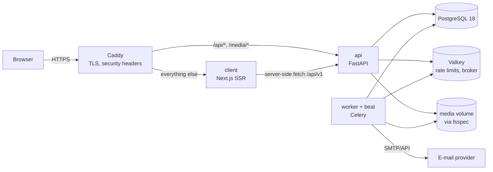
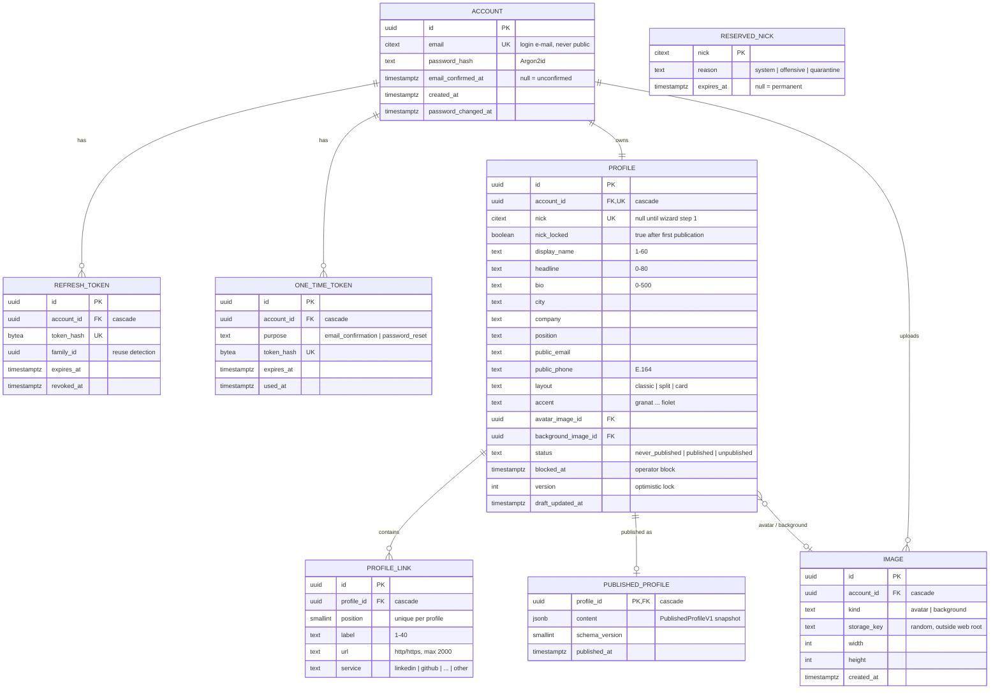

# Architecture

Modular monolith. Product areas: `docs/product/areas/`. Decisions: `docs/decisions/`. API contract: `docs/api/openapi.yaml`.

## Runtime

| Container | Responsibility |
|---|---|
| `caddy` | TLS (Let's Encrypt), HSTS and other headers, strict fallback CSP (pages send their own with a script nonce), routing, gzip/zstd |
| `client` | Next.js: landing, legal pages, `/user/{nick}` (SSR, no cache), owner panel (client components) |
| `api` | FastAPI `/api/v1/**`, `/media/**`, `/health`, `/ready` |
| `worker` | Celery tasks: e-mails, image processing, cleanup |
| `beat` | Celery Beat schedule (single instance) |
| `db`, `valkey` | PostgreSQL 18, Valkey 9 |

## Backend modules (`api/app/modules/`, shared code in `api/app/core/`)

| Module | Product area | Owns tables | Public interface for other modules |
|---|---|---|---|
| `accounts` | Accounts | `accounts`, `refresh_tokens`, `one_time_tokens` | `get_account`, `is_email_confirmed`, `delete_account` (emits `AccountDeleted`) |
| `profiles` | Profile, Public page | `profiles`, `profile_links`, `published_profiles`, `reserved_nicks` | `create_profile_for(account)`, `get_public_profile(nick)`, `block(nick)` |
| `media` | Profile (images) | `images` | `store_upload(...)`, `url_for(image, size)`, `delete_for_account(id)` |
| `notifications` | All | — | `send(template, to, params)` as a Celery task; templates in Polish |
| `qr` | Public page | — | `render(url, format)` |
| `core` (`api/app/core/`) | — | — | settings, DB session, Valkey client, request context, Problem Details, logging, health; later auth dependencies, rate limiter, storage adapter |

Rules: a module reads and writes only its own tables; other modules call its service functions. Account deletion: `accounts` deletes the account in one transaction (FK cascades remove profile, links, snapshot, image rows), then enqueues `media.delete_files(account_id)` and the "account deleted" e-mail. `ops` CLI commands (`profilo block-profile <nick>`, `unblock-profile`) cover operator actions (PUB-BR-10) — no admin panel in v1.

## Frontend (`client/`)

- Next.js App Router, TypeScript strict, styling: CSS Modules + `docs/design/tokens.css` imported globally; components follow `docs/design/components.css` and `design-system.html`.
- API types and client generated from `docs/api/openapi.yaml` (`openapi-typescript` + `openapi-fetch`).
- Forms: React Hook Form + Zod schemas mirroring the contract; autosave with debounce 1 s (PRF-BR-14).
- Link reordering: `@dnd-kit/sortable` with keyboard support and ↑/↓ buttons on mobile.
- Access token in memory, refreshed via `POST /api/v1/auth/refresh` (HttpOnly cookie).

## Data model

Key constraints: `CHECK` on all lengths and enums; `CHECK (nick ~ '^[a-z0-9]+(-[a-z0-9]+)*$' AND length(nick) BETWEEN 3 AND 40)`; nick uniqueness checked against `profiles.nick` and `reserved_nicks` in one transaction (`SELECT … FOR UPDATE` on the reserved row, unique index on `profiles.nick`); `UNIQUE (profile_id, position) DEFERRABLE` for link reordering; at most 20 links enforced in the service and by a trigger-free count check in the same transaction.

Public read path: `GET /api/v1/public/profiles/{nick}` → `profiles` by nick where `status = 'published' AND blocked_at IS NULL` → `published_profiles.content`. Anything else → the same 404 (PUB-BR-6).

## Media

- Upload: `multipart/form-data` to the API, max 10 MB (Caddy limits the body to 11 MB, the API checks `Content-Length` before parsing), type detected from content (Pillow, JPEG/PNG/WebP only), 24 Mpx limit against decompression bombs, at most two images decoded at a time, EXIF orientation applied and all metadata dropped, converted to WebP.
- Sizes: avatar 128/256/512 px square; background 960/1600/2400 px wide.
- Link previews (PUB-BR-7): `GET /api/v1/public/profiles/{nick}/og-image.jpg` draws a 1200 × 630 JPEG card (accent background, the 512 px avatar or initials, name, headline, page address, wordmark) with Pillow and the bundled Plus Jakarta Sans (`api/app/assets/fonts/`, OFL). One card for every page instead of the bare avatar: messengers crop a square photo badly and some show no text. Rendered in its own two-thread pool after the request has given back its database connection, at most 60 renders per minute per IP (cached cards are not counted), cached in Valkey per renderer and published draft version (`og:{VERSION}:{profileId}:{draftVersion}`, 7 days, fails open), served with `public, max-age=86400`; the page links it as `?v={draftVersion}` so a republish gets a fresh preview. Hidden pages get the page's 404.
- Served by `GET /media/{imageId}/{size}.webp` through the API: allowed when the image belongs to the owner (draft preview, authenticated) or is referenced by a visible published snapshot. URLs never change content (new upload = new id); published images are cached for a day (`public, max-age=86400`) so unpublishing or blocking takes effect soon, drafts are `private, no-store`.

## Authentication

- Access token: JWT (PyJWT, HS256 with a 256-bit secret, `iss`/`aud`/`exp` checked), 15 min, in memory in the browser; the client refreshes it 60 s before expiry. `iat` carries fractional seconds; tokens issued before the account's `password_changed_at` (with 1 ms slack) are refused, so a password reset or change ends every session at once (TASK-015).
- Password reset (ACC-BR-7): `POST /auth/password-resets` always answers 202; the lookup, the one-time token (`one_time_tokens`, purpose `password_reset`, 1 h, a new one replaces older ones) and the e-mail run in a background task after the response, so neither the body nor the timing tells whether the account exists. Limits: 5 requests per IP (IPv6: per /64) per hour (429), 3 per address per hour and 150 reset e-mails per day in total, counted for existing accounts only (extra requests dropped silently). `/confirm` sets the password, revokes every refresh token, refuses older access tokens, marks the e-mail confirmed, logs this browser in and sends a security notice. Lock order account → refresh token in login, refresh and reset (login and refresh take the account `FOR SHARE`, the reset `FOR UPDATE`), so no session created or rotated during a reset survives it. Caddy redacts the `token` query parameter in its access log; `/nowe-haslo` drops it from the address bar after reading it.
- Refresh token: random 256-bit, stored as SHA-256 hash, 30 days sliding (ACC-BR-8), rotated on every use with reuse detection by family (a reuse within 30 s — parallel tabs, a lost response — gets a sibling token; later reuse revokes the family); HttpOnly, Secure, `SameSite=Strict`, path `/api/v1/auth`. Refresh and logout additionally require header `X-Requested-With: profilo` (CSRF defence in depth).
- Passwords: Argon2id via `pwdlib`; common password check against the ~30 000 most common passwords bundled with `zxcvbn` (no external call).
- E-mail confirmation and password reset tokens: random, hashed, single-use, 48 h / 1 h.

## Personal and sensitive data

| Data | Where | Protection |
|---|---|---|
| Login e-mail | `accounts.email` | Never returned by public endpoints; not in logs (account id only) |
| Password | `accounts.password_hash` | Argon2id |
| Refresh / one-time tokens | `refresh_tokens`, `one_time_tokens` | Stored as hashes only |
| Public e-mail, phone, name, bio, city, company, position | `profiles`, `published_profiles` | Public only when the owner fills them in and publishes; deleted with the account |
| Photos | `images`, media volume | EXIF removed; served only for owner or visible pages; deleted with the account |
| IP addresses | Valkey rate-limit keys (as a keyed hash, TASK-027) | TTL ≤ 1 h; not stored in the database; logs keep IP only in Caddy access logs, 14 days |

Retention: unconfirmed accounts deleted after 7 days; deleted accounts removed immediately (backups age out after 30 days — stated in the privacy policy; restic `forget --keep-within 30d --prune`, TASK-022).

## Higher-risk flows

| Flow | Risk | Mitigation |
|---|---|---|
| Login, registration, reset | Credential stuffing, enumeration, mailbombing | Rate limits per IP and per e-mail in Valkey; identical responses for login and reset; registration may reveal an existing e-mail (409 `email_taken`, pointing to login and reset) but has a low per-IP limit (10 per hour; IPv6 counted per /64) and a self-hosted proof-of-work challenge (ALTCHA format, no third-party processor) from the 4th attempt per IP per hour; challenge events are logged without IP or e-mail |
| Session | Token theft | Short access token, rotating refresh with reuse detection, revoke all on password change/reset |
| Profile content | Stored XSS, phishing links | React escaping; URLs restricted to `http`/`https`; `rel="nofollow ugc noopener noreferrer"`; strict CSP (scripts only with a per-request nonce) |
| Image upload | Malicious files, metadata leaks | Content sniffing, size and pixel limits, re-encoding, EXIF removal, random keys, no direct file serving |
| Nick | Takeover of shared addresses, impersonation | Nick locked after first publication; 30-day quarantine after deletion; reserved list |
| Unpublish / block | Stale content visible | No caching of public pages; snapshot visibility checked on every request |
| Account deletion | Accidental or hostile deletion, data left behind | Password required (5 wrong passwords per account per 15 min, shared with the password change; like login, the limit fails open when Valkey is down); confirmation e-mail; cascade in one transaction; files removed by a task (directly when the queue is down); cached preview cards dropped |

## External services and costs

Approved on 2026-11-09 (prices from public sources then, without VAT; check before ordering). Staging runs on the owner's shared VPS instead of a separate Hetzner server (runbook „Shared host”).

| Service | Purpose | At start | Growth (≈ 5 000–10 000 owners) |
|---|---|---|---|
| Hetzner Cloud CX33 ([ADR 0004](decisions/0004-hosting-single-vps-docker-compose.md)) | Production server | ≈ €9/month | CX43 ≈ €15–17/month |
| Hetzner Storage Box | Off-site backups (TASK-022) | ≈ €4/month | same |
| Brevo ([ADR 0005](decisions/0005-transactional-email-brevo.md)) | Transactional e-mail (SMTP; staging on port 2525) | free, 300 e-mails/day | Starter ≈ €9–14/month |
| Sentry (EU region) | Error reporting | free (Developer) | Team ≈ $26/month |
| Better Stack Uptime | Uptime monitor, backup heartbeat | free | free |
| Let's Encrypt, ALTCHA (self-hosted) | TLS, registration bot protection | free | free |
| Domain `.pl` | | ≈ 50–150 PLN/year | same |

## Code map

| Path | Responsibility | State |
|---|---|---|
| `api/app/main.py` | FastAPI app factory: error handlers, request-context middleware, routers | TASK-001 |
| `api/app/core/settings.py` | Settings from environment (`Settings`, `get_settings`) | TASK-001 |
| `api/app/core/db.py` | Async SQLAlchemy engine, session dependency, declarative `Base` | TASK-001 |
| `api/app/core/valkey.py` | Shared Valkey (Redis protocol) client | TASK-001 |
| `api/app/core/errors.py` | Problem Details responses, `ProblemError`, handlers for HTTP and validation errors | TASK-001 |
| `api/app/core/request_context.py` | Pure ASGI middleware: `X-Request-ID`, log context, single log + 500 Problem for unhandled errors | TASK-001 |
| `api/app/core/health.py` | `/health`, `/ready` (PostgreSQL and Valkey in parallel, one timeout) | TASK-001 |
| `api/app/core/logging.py` | structlog JSON to stdout; uvicorn access log disabled | TASK-001 |
| `api/app/worker.py` | Celery app (`worker`, `beat`), task autodiscovery per module package | TASK-001 |
| `api/app/modules/<module>/` | Product modules (empty packages until their tasks) | — |
| `api/alembic/` | Migrations (`0001`: citext extension) | TASK-001 |
| `api/tests/` | pytest; integration tests use the `profilo_test` database | TASK-001 |
| `api/app/core/auth.py`, `core/rate_limit.py`, `core/schemas.py` | Bearer-token dependency, Valkey fixed-window limits (fail open; keys hold an HMAC of the subject, never an e-mail or IP), camelCase API base model | TASK-004, TASK-027 |
| `api/app/modules/accounts/` | Accounts and refresh tokens: models, Argon2id + common-password policy, JWT and rotating refresh tokens with reuse detection, service, router (`/accounts`, `/auth/*`, `/me`) | TASK-004 |
| `api/app/modules/profiles/` | Profile model (draft), `create_profile_for` | TASK-004 |
| `api/app/modules/profiles/nicks.py`, `service.py`, `router.py` | Nick rules (PRF-BR-2, mirrored in `client/src/lib/nick.ts`; shared test cases in `docs/api/nick-cases.json`), reserved nicks (`0004` seeds system and offensive words; offensive ones also block nicks containing them), suggestions, availability, suggestion and save (shared 120/min limit), `PUT /me/profile/nick`; `GET`/`PATCH /me/profile` with optimistic locking and E.164 phones | TASK-006 |
| `api/app/modules/accounts/password_reset.py`, `client/src/features/auth/ResetRequestForm.tsx`, `NewPasswordForm.tsx`, `client/src/app/nie-pamietam-hasla/`, `client/src/app/nowe-haslo/` | Password reset: request (background lookup and e-mail), confirm (new session, all others ended), templates `password_reset` and `password_changed`; „Nie pamiętam hasła” on the login page and in the `email_taken` message | TASK-015 |
| `api/app/modules/accounts/sessions.py`, `service.change_password`, `service.delete_account`, `profiles/service.quarantine_nick_of`, `media/tasks.py`, `client/src/features/account/`, `client/src/app/panel/konto/`, `client/src/app/konto-usuniete/`, `client/src/components/Modal.tsx` | Account settings: `PUT /me/password` (confirmed accounts; every session ends, this browser gets a new one), `POST /me/deletion` (password; cascade delete, nick quarantined 30 days, files removed by the Celery task `media.delete_account_files`, confirmation e-mail); 5 wrong passwords per account per 15 min shared by both; panel menu „Ustawienia konta”, deletion dialog from the design system, goodbye page that signs out; shared `Modal` (focus trap) | TASK-016 |
| `api/app/core/jobs.py`, `api/app/worker.py` (beat schedule), `accounts/cleanup.py` + `accounts/tasks.py`, `profiles/tasks.py` + `service.release_quarantined_nicks`, `media/tasks.py` + `service.remove_orphaned_files`, `media/storage.stored_keys`, `remove_empty_folders` | Cleanup jobs, hourly in Celery Beat (minute 5, 15, 25): unconfirmed accounts older than 7 days deleted in batches of 100 with `SKIP LOCKED` (nick released at once, files and cached cards removed after the commit); expired quarantines removed; stored images without a row and empty account folders removed once older than 1 hour. One run at a time per job (Valkey lock `job:{name}`, fails closed); `job_done` logs with counts; each run disposes the loop-bound engine and Valkey client | TASK-017 |
| `api/app/core/proof_of_work.py`, `service.register` (`CHALLENGE_AFTER`), `client/src/lib/proofOfWork.ts`, `proofOfWork.worker.ts` | Registration bot protection: from the 4th attempt per IP within an hour `POST /accounts` answers 428 `challenge_required` with an ALTCHA-format challenge (SHA-256, secret number up to 500 000, HMAC signature with a key derived from the JWT secret, expiry in the salt, 10 min, accepted once via Valkey); the form solves it in a web worker (synchronous plain-JS SHA-256) and sends again; self-hosted, no new dependency | TASK-018 |
| `client/src/features/landing/`, `client/src/app/page.tsx`, `client/src/app/przyklad/`, `client/src/features/legal/`, `client/src/app/regulamin/`, `client/src/app/prywatnosc/`, `client/src/lib/operator.ts`, `client/src/components/SiteHeader.tsx` | Landing per mockup: „Zarezerwuj adres” is a plain GET form to `/rejestracja?adres=…` (works without JS), the address goes through registration to `/kreator?adres=…`, where step 1 checks it at once (taken → suggestions); the example page in a phone frame is `/przyklad` (sample data, `noindex`, framable by the same origin like `/podglad`). Legal drafts (terms with DSA notice-and-action, privacy policy per GDPR art. 13) with operator data from `lib/operator.ts`, missing values shown as marked placeholders | TASK-019 |
| `api/app/cli.py`, `profiles/service.set_blocked`, `api/app/models.py`, `client/src/features/panel/BlockedNotice.tsx`, `client/src/lib/operator.ts` (`abuseEmail`) | Operator CLI in the api image (`profilo block-profile|unblock-profile <nick>`, wrapper in `/usr/local/bin`): blocking sets `profiles.blocked_at` (public page, card and images 404 at once, publish 403 `profile_blocked`, cached preview cards dropped), unblocking shows the last snapshot again; idempotent; the owner sees „Strona zablokowana — skontaktuj się z nami” in the panel and editor. „Zgłoś nadużycie” uses `ABUSE_EMAIL` (client env, read per request by the public page, the preview and the terms; a non-deliverable `profilo.invalid` placeholder while empty or malformed). Deleting the account of a blocked page reserves its nick for good (`reserved_nicks` reason `blocked`, migration `0008`). `app/models.py` registers every model for entry points that do not start through `app.main` | TASK-020 |
| `api/app/modules/accounts/confirmation.py` | E-mail confirmation tokens (48 h, single use, resend invalidates earlier ones), confirm and resend | TASK-005 |
| `api/app/modules/notifications/` | `send()` (queues after commit, never fails the caller), Celery task with retries, SMTP adapter, Jinja2 templates (HTML + text, Polish) | TASK-005 |
| `client/src/features/auth/ConfirmEmail*.tsx`, `client/src/app/potwierdz-email/` | Confirmation page (success, expired, logged-out redirect) and the panel banner with resend | TASK-005 |
| `client/src/app/` | Next.js App Router: `layout.tsx` (font, metadata, tokens, session provider), home, `/rejestracja`, `/logowanie`, `/panel` (guarded shell), `/regulamin`, `/prywatnosc` | TASK-001, TASK-004 |
| `client/src/lib/api/` | `schema.d.ts` generated from the contract (`npm run api:types`, checked by `api:check`), `client.ts` (openapi-fetch, in-memory access token, silent refresh) | TASK-004 |
| `client/src/lib/session.tsx`, `client/src/features/auth/` | Session context; registration and login forms (React Hook Form + Zod) | TASK-004 |
| `client/src/app/kreator/`, `client/src/features/wizard/`, `client/src/lib/useRequireSession.ts` | Wizard shell (stepper, „Dokończę później”), step 1 with live nick check and suggestion chips; session guard shared with `/panel` | TASK-006 |
| `api/app/modules/profiles/` (publishing) | `published_profiles` snapshot (`0005`, `PublishedProfileV1` = `ProfileContentOut`), `POST /me/profile/publish` and `/unpublish`, `GET /public/profiles/{nick}` (`Cache-Control: no-store`, one 404 for every hidden page) | TASK-007 |
| `client/src/app/user/[nick]/`, `client/src/features/public/`, `client/src/lib/publicProfile.ts` | Public page rendered on the server from `API_INTERNAL_URL` (no data cache, canonical-nick redirect); `PublicPage` renders Classic, Split and Card (TASK-012); `app/not-found.tsx` + `components/NotFoundPage.tsx` shared 404 | TASK-007 |
| `client/src/features/panel/PublishPanel.tsx` | Panel: page status badge, „Opublikuj” / „Opublikuj zmiany” / „Ukryj stronę”, reasons why publishing is disabled | TASK-007 |
| `client/src/app/edytor/`, `client/src/features/editor/` | Editor: `useAutosave` (1 s debounce, only changed fields, optimistic `version`, invalid fields held back, conflict stops saving, unsaved changes kept in `localStorage` per account), form sections „O mnie” and „Kontakt”, save state and publish in the top bar, preview placeholder and phone tabs | TASK-008 |
| `client/src/lib/phone.ts` | Phone prefixes, E.164 → grouped display (`libphonenumber-js`), editor split and save value | TASK-008 |
| `api/app/modules/profiles/links.py`, `service.py` (links) | URL rules (http/https only, `https://` added, no spaces, other schemes or `user@`), service detection and default labels; `profile_links` (`0006`, position unique per profile and checked at commit), add / update / delete / reorder under the profile lock, each bumping the draft version; links are part of the published snapshot | TASK-009 |
| `client/src/features/editor/LinksSection.tsx`, `client/src/components/LinkIcon.tsx` | Links in the editor (empty state, inline form, `@dnd-kit` drag and drop with keyboard and Polish announcements, ↑/↓ on phones); link changes run through `useAutosave.exclusive` so they never race an autosave; service tiles shared with the public link cards | TASK-009 |
| `api/app/modules/media/` | Images: `processing.py` (Pillow: type from content, 24 Mpx limit, reduced decoding, sRGB, first frame, EXIF orientation applied, WebP variants without metadata), `storage.py` (fsspec, `MEDIA_URL`), `images` table (`0007`), `service.py` (`store_upload` with 30/h limit, `urls_for`, `prune`), `router.py` (`GET /media/{imageId}/{size}.webp`: owner or visible published page, same 404 otherwise; public one day / private no-store) | TASK-010 |
| `api/app/modules/profiles/` (images) | `PUT`/`DELETE /me/profile/images/{kind}` (request length checked before parsing), avatar/background on the draft and in the snapshot, unused images deleted once neither the draft nor the snapshot shows them | TASK-010 |
| `client/src/features/editor/ImagesSection.tsx`, `CropDialog.tsx`, `cropImage.ts`, `client/src/components/OwnerImage.tsx` | Photo (square crop with `react-easy-crop`, JPEG ≤ 1024 px from a canvas) and background uploads with progress (`uploadWithProgress`), errors, remove; draft images shown through `authorizedFetch` blob URLs; public page uses `srcset` | TASK-010 |
| `client/src/app/podglad/`, `client/src/features/preview/` | Live preview (ADR 0001): `/podglad` renders the shared `ClassicPage` from a draft sent by `postMessage`; `LivePreview` frames it at 1280 or 390 px (Komputer/Telefon) and scales it; `draftToPublic` merges typed, unsaved values; draft images go in as blob URLs fetched with the token | TASK-011 |
| `client/src/app/kreator/tresc/`, `client/src/app/kreator/podglad/`, `client/src/features/wizard/PreviewStep.tsx`, `WizardBar.tsx` | Wizard step 3 (the editor without its top bar, with a bottom bar) and step 4 (full preview, „Opublikuj stronę”, hint when the e-mail is not confirmed); the stepper follows the path | TASK-011 |
| `e2e/` | Playwright main flow (`make e2e`, CI job `e2e`): register → nick → content → preview → confirm via Mailpit → publish → public page equals the preview | TASK-011 |
| `client/src/features/appearance/`, `client/src/app/kreator/wyglad/`, `client/src/features/wizard/AppearanceStep.tsx` | Layout and accent pickers (radio groups with arrow keys), wizard step 2 and the editor's „Wygląd” section; layout and accent are autosaved draft fields | TASK-012 |
| `e2e/tests/layouts.spec.ts`, `e2e/tests/helpers.ts` | Every layout × accent: axe (WCAG 2.1 AA) at 1440 px, no horizontal scroll at 320/1440 px; text contrast ≥ 4.5:1 on a very light background image by pixel sampling | TASK-012 |
| `api/app/modules/profiles/og_image.py`, `service.og_card`, `service.sitemap`, `api/app/assets/fonts/` | Open Graph card renderer (pure, Pillow) and its cached endpoint; `GET /public/sitemap` (visible published pages, newest first, max 50 000); `PublicProfile.ogImageUrl` | TASK-013 |
| `client/src/lib/seo.ts`, `client/src/lib/site.ts`, `client/src/app/robots.ts`, `client/src/app/sitemap.ts` | Public page title, description (bio or details), canonical URL, Open Graph, Twitter card and schema.org `ProfilePage` JSON-LD; `robots.txt` and `sitemap.xml` built per request from `PUBLIC_BASE_URL`; `PRIVATE_PAGE` (`noindex, nofollow`) on `/panel`, `/kreator`, `/edytor` via server `layout.tsx` + client `Shell.tsx` | TASK-013 |
| `api/app/modules/qr/`, `GET /me/profile/qr` (`profiles/router.py`, `service.qr_code`) | QR code of the canonical page URL (segno, error level M): SVG (default; viewBox in modules, nominal 1024 px, crisp edges) or PNG exactly 1024 × 1024 drawn module by module with Pillow; navy modules on white, 4-module quiet zone; attachment `profilo-{nick}.{format}`; 409 `not_published` before the first publication and `page_blocked` for a blocked page, still available while the page is hidden | TASK-014 |
| `client/src/features/share/`, `client/src/app/opublikowano/` | `SharePanel` (address, „Kopiuj link” with the Clipboard API and a legacy fallback, toast „Skopiowano link”, „Otwórz stronę”, QR preview and PNG/SVG downloads through `authorizedFetch` + blob URLs), the „Opublikowano” screen after the first publication (wizard and editor), `ShareDialog` from the editor's „Udostępnij” button (focus trap, Escape, click outside) | TASK-014 |
| `e2e/tests/seo.spec.ts` | Preview tags, og:image 200, sitemap entry; after unpublishing gone from the sitemap and 404; panel pages `noindex` | TASK-013 |
| `infra/` | Local Caddy config, PostgreSQL init (test database) | TASK-001 |
| `infra/server/` | Server bootstrap (`bootstrap.sh`, `setup-shared-host.sh`), staging/production Compose stack, Caddyfile with TLS and security headers, `deploy.sh`: pre-migration dump, migrations unless the database is ahead, blue-green switch (`api-`/`client-blue|green`, Caddy pointed at the ready colour via `caddy/upstreams.caddy`), smoke tests, instant switch back on failure, `--rollback` to a release in `.deployed-history` | TASK-003, TASK-021 |
| `api/app/core/monitoring.py`, `api/app/modules/monitoring/` | Sentry setup, event scrubbing, error-level logs as events; browser error tunnel (`POST /api/v1/monitoring/sentry`) | TASK-023 |
| `client/src/instrumentation*.ts`, `client/src/lib/monitoring/` | Sentry in the Next.js server and the browser (tunnel), client-side scrubbing | TASK-023 |
| `infra/ci/sentry-release.sh` | Sentry release, source maps from the client image, deployment record (deploy workflows) | TASK-023 |
| `client/src/proxy.ts`, `client/src/lib/csp.ts` | Per-request nonce and the page Content-Security-Policy (scripts by nonce, framable pages) | TASK-024 |
| `infra/backup/` | Backup image (PostgreSQL client + restic + curl) and `profilo-backup` (scheduler, backup, restore test, alerts, `dump-db`, `restic`) | TASK-022 |
| `infra/ci/deploy-remote.sh` | Runner side of all deploy workflows: SSH with pinned host key, upload of the commit's stack files, runtime secrets, GHCR login, `deploy.sh`, external smoke tests | TASK-021 |
| `.github/workflows/` | `ci.yml` (check, publish), `deploy-staging.yml` (sets the commit status `deploy/staging`), `deploy-production.yml` (user only; requires `deploy/staging`; release tag `production-*`), `rollback-production.yml` (only `production-*` releases) | TASK-002, TASK-003, TASK-021 |
