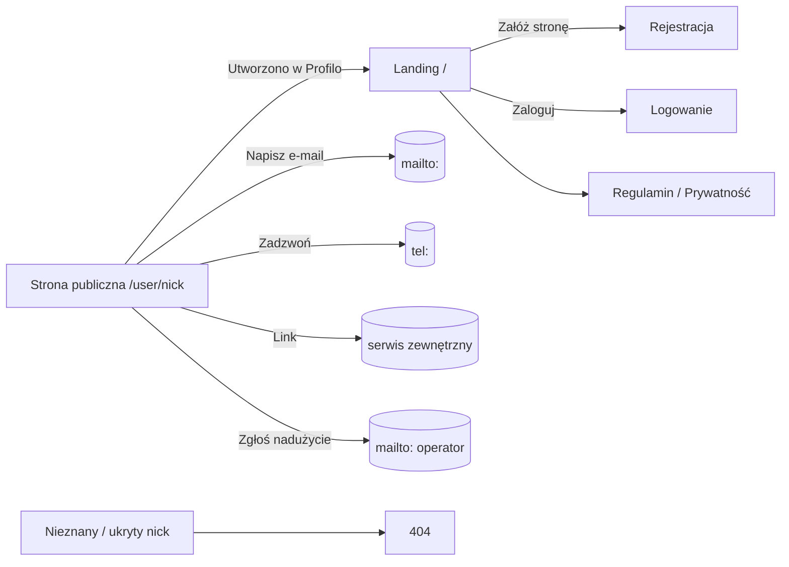
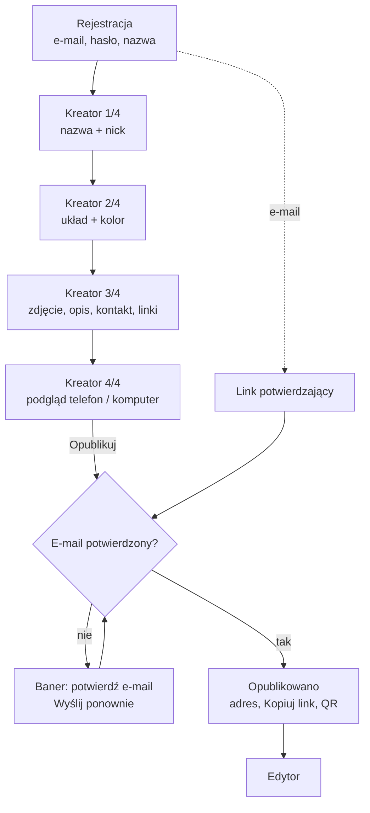
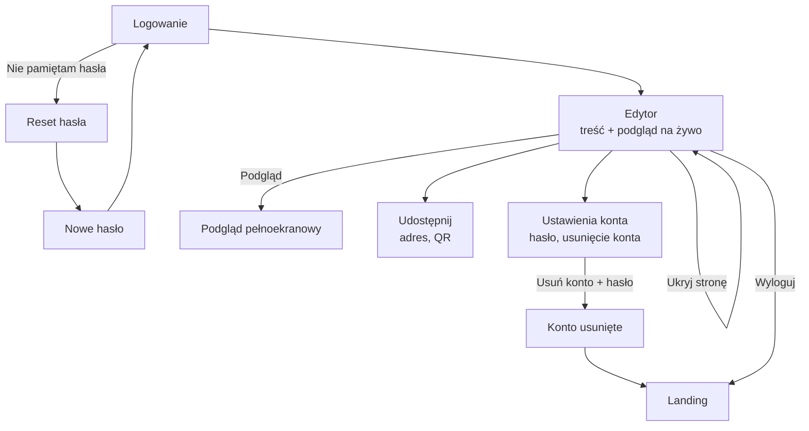

# User flows

Screens and transitions per role for version 1. Story and rule IDs refer to `docs/product/`.

## Visitor

## Owner — first publication (main flow, target ≈ 5 min)

## Owner — returning

## Screens

| # | Screen | Role | Key | Stories |
|---|---|---|---|---|
| 1 | Strona publiczna — Klasyczny / Dzielony / Wizytówka | Visitor | ✔ | PUB-US-1…4 |
| 2 | Landing | Visitor | ✔ | — |
| 3 | Rejestracja | Visitor | ✔ | ACC-US-1 |
| 4 | Kreator 1/4: nazwa i nick (z wariantami przy zajętym) | Owner | ✔ | PRF-US-1, 2 |
| 5 | Kreator 2/4: układ i kolor | Owner | ✔ | PUB-US-1, 2 |
| 6 | Edytor / Kreator 3/4: treść, zdjęcia, kontakt, linki + podgląd | Owner | ✔ | PRF-US-3…8 |
| 7 | Opublikowano: adres, Kopiuj link, QR | Owner | ✔ | PRF-US-9, PUB-US-6 |
| 8 | Logowanie | Visitor | | ACC-US-3 |
| 9 | Reset hasła (prośba, nowe hasło) | Visitor | | ACC-US-4 |
| 10 | Potwierdzenie e-maila (sukces, link wygasł) | Owner | | ACC-US-2, 7 |
| 11 | Ustawienia konta (hasło, usunięcie) | Owner | | ACC-US-5, 6 |
| 12 | 404, Regulamin, Polityka prywatności | Visitor | | PUB-BR-6, 11 |

Key screens (1–7) get sketch and final mockups. Screens 8–12 are built from design-system components following the key screens.
