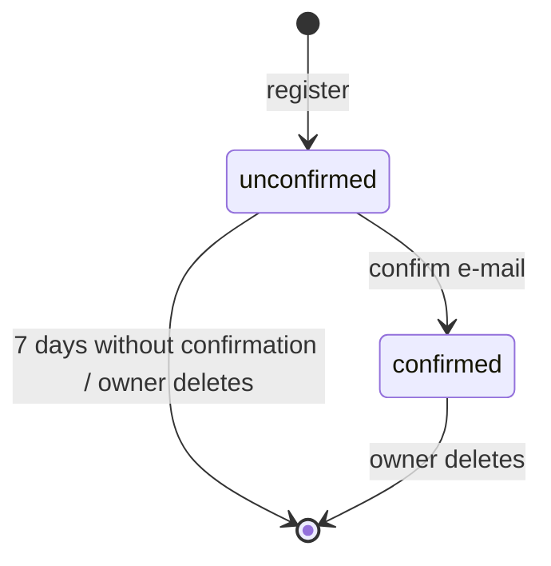

# Accounts

## Purpose

Lets a person register, confirm their e-mail, log in and out, recover or change the password and delete the account together with the profile.

## Roles and permissions

| Role | Can |
|---|---|
| Visitor | Register, log in, request password reset |
| Owner (unconfirmed e-mail) | Log in, edit the profile draft, resend the confirmation e-mail, delete the account; cannot publish |
| Owner (confirmed) | Everything above plus publish; change password |

## User stories

- ACC-US-1: As a visitor, I want to register with my e-mail, password and display name, so that I can start creating my page.
- ACC-US-2: As an owner, I want to confirm my e-mail with a link, so that I can publish my page.
- ACC-US-3: As an owner, I want to log in and log out, so that only I can edit my page.
- ACC-US-4: As an owner, I want to reset a forgotten password via e-mail, so that I do not lose access to my page.
- ACC-US-5: As an owner, I want to change my password while logged in, so that I can keep my account secure.
- ACC-US-6: As an owner, I want to delete my account and profile permanently, so that my data no longer exists in the service.
- ACC-US-7: As an owner with an unconfirmed e-mail, I want to resend the confirmation link, so that I can finish registration if the e-mail got lost.

## Business rules

- ACC-BR-1: One account per login e-mail; e-mail comparison is case-insensitive.
- ACC-BR-2: Registration requires login e-mail, password and display name, plus acceptance of the terms of service and acknowledgement of the privacy policy.
- ACC-BR-3: Password: 10–128 characters, rejected if it appears on a list of common/breached passwords. No composition rules.
- ACC-BR-4: The user is logged in right after registration. Until the e-mail is confirmed, the panel shows a banner and the publish action is disabled.
- ACC-BR-5: The confirmation link is valid for 48 hours and single-use; resending invalidates earlier links.
- ACC-BR-6: An account whose e-mail is not confirmed within 7 days is deleted automatically together with its draft, and its nick is released immediately.
- ACC-BR-7: Password reset link is valid for 1 hour and single-use. The reset form responds identically whether or not the e-mail exists. After a reset all other sessions are logged out.
- ACC-BR-8: A session lasts 30 days from the last activity; logout ends the current session only.
- ACC-BR-9: Account deletion requires the current password, is immediate and irreversible, and removes the profile, images and sessions. The public page returns 404 at once.
- ACC-BR-10: After account deletion the nick is reserved for 30 days (quarantine) so that a stranger cannot take over a recently shared address; then it is released.
- ACC-BR-11: The login e-mail is never published or shown to visitors.

## Statuses

| From | To | Trigger | Who |
|---|---|---|---|
| — | unconfirmed | Registration | Visitor |
| unconfirmed | confirmed | Opening a valid confirmation link | Owner |
| unconfirmed | deleted | 7 days passed / delete account | System / Owner |
| confirmed | deleted | Delete account | Owner |

## Limits and validation

- Display name at registration: 1–60 characters after trimming.
- Rate limits: login 5 failed attempts per account per 15 minutes and per IP; registration and reset requests limited per IP; resend confirmation once per minute.

## Notifications

| Event | E-mail to owner |
|---|---|
| Registration | Confirmation link |
| Resend confirmation | Confirmation link |
| Password reset requested | Reset link |
| Password changed or reset | Security notice |
| Account deleted | Confirmation of deletion |

## Edge cases

- Confirmation link opened while logged out: confirms and asks to log in.
- Confirmation link opened after it expired: message with "Send a new link" button.
- Registration with an e-mail already registered: message „Konto z tym adresem już istnieje. Zaloguj się albo zresetuj hasło.” Registration is protected against mass address checking by a low per-IP limit and a proof-of-work challenge (ALTCHA) after 3 attempts per IP per hour. (A generic response is impossible because the user is logged in right after registration — ACC-BR-4.)
- Deleting an account in one browser while editing in another: the other session gets "Session expired" on next save.

## Open questions

None. Login e-mail change is out of v1 (Later, Should).
