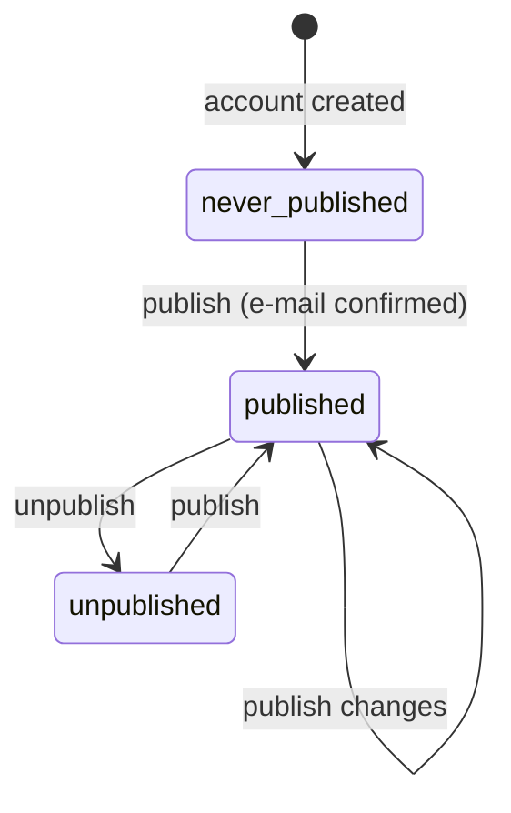

# Profile

## Purpose

Lets the owner fill in their page content, choose a nick, edit a draft, preview it and publish or unpublish it.

## Roles and permissions

| Role | Can |
|---|---|
| Owner | Edit own draft, set nick before first publication, preview, publish, unpublish |
| Visitor | Nothing here — sees only the published version (see Public page) |

## User stories

- PRF-US-1: As a new owner, I want a short guided wizard (name and nick → layout → content → preview → publish), so that I can publish my page in about five minutes.
- PRF-US-2: As an owner, I want a nick proposed from my display name and to change it before first publication, so that my address is short and recognisable.
- PRF-US-3: As an owner, I want to fill in display name, headline, bio, city, company and position, so that visitors know who I am.
- PRF-US-4: As an owner, I want to upload a profile photo and an optional background image, so that my page looks personal.
- PRF-US-5: As an owner, I want to add a public e-mail and phone number, so that visitors can contact me in one tap.
- PRF-US-6: As an owner, I want to add, label, reorder and remove links, so that visitors find my profiles.
- PRF-US-7: As an owner, I want my changes saved automatically as a draft, so that I do not lose work and visitors do not see unfinished changes.
- PRF-US-8: As an owner, I want to preview the draft on phone and desktop sizes, so that I know how the page will look.
- PRF-US-9: As an owner, I want to publish changes and unpublish my page, so that I control what visitors see.

## Business rules

### Nick

- PRF-BR-1: Nick length 3–40 characters; allowed `a–z`, `0–9` and single hyphens; no hyphen at the start or end. Regex: `^[a-z0-9]+(-[a-z0-9]+)*$`.
- PRF-BR-2: Proposal from display name: lowercase, Polish letters transliterated (ą→a, ć→c, ę→e, ł→l, ń→n, ó→o, ś→s, ź→z, ż→z; other diacritics removed by Unicode decomposition), spaces and other separators → hyphen, other characters removed, repeated hyphens collapsed, trimmed to 40 characters at a word boundary. If the result is shorter than 3 characters, no proposal is made.
- PRF-BR-3: The nick input applies the same normalisation as the user types, and shows availability live; the authoritative check (format, uniqueness, reserved list) runs on save.
- PRF-BR-4: A nick is unavailable if it is used by another account, is in quarantine (ACC-BR-10) or is on the reserved list (system words such as `admin`, `api`, `app`, `user`, `login`, `logowanie`, `rejestracja`, `konto`, `panel`, `help`, `pomoc`, `regulamin`, `prywatnosc`, `support`, `www`, `mail`, `static`, plus the product name and common offensive words).
- PRF-BR-5: When a nick is unavailable the system suggests up to 3 free variants: `{nick}-2`, `{nick}-3` …, and if the display name has a city, `{nick}-{city}`.
- PRF-BR-6: The nick is assigned to the account when the wizard's first step is saved (it is unique across drafts too), so two users cannot publish with the same nick.
- PRF-BR-7: The nick can be changed until the first publication. After the first publication it is permanent, also after unpublishing.

### Content

- PRF-BR-8: Required to publish: confirmed login e-mail, display name, nick. All other fields are optional; the avatar falls back to initials on the accent colour.
- PRF-BR-9: Each optional field is shown publicly only if filled in; empty fields leave no gaps or labels on the page.
- PRF-BR-10: Public e-mail is a separate field from the login e-mail and is not pre-filled with it.
- PRF-BR-11: Links: up to 20; URL must use `http` or `https` (scheme `https://` added when missing); label 1–40 characters, defaults to the domain name. The service icon is chosen automatically for known domains (LinkedIn, GitHub, X, Instagram, Facebook, YouTube, Behance, Dribbble, TikTok), otherwise a generic link icon.
- PRF-BR-12: Phone is stored in international format (E.164), default country Poland (+48), displayed grouped, linked with `tel:`.
- PRF-BR-13: Images: JPEG, PNG or WebP, up to 10 MB. Avatar is cropped to a square in the browser; stored sizes are generated on the server; EXIF metadata (including location) is removed.

### Draft and publication

- PRF-BR-14: Every change is saved to the draft automatically within 1 second of the last edit; the editor shows "Saved" / "Saving…" / "Not saved — retry".
- PRF-BR-15: "Publish changes" copies the whole draft, including layout, colour and link order, to the published version in one operation. Visitors never see a partial draft.
- PRF-BR-16: The panel shows whether the draft has unpublished changes.
- PRF-BR-17: Unpublishing makes the public address return 404 immediately; content and the published snapshot are kept; publishing again shows the current draft.
- PRF-BR-18: Preview shows the draft exactly as the public page would render it, with a phone/desktop toggle, and is visible only to the owner.
- PRF-BR-19: After the first publication the owner sees the full address with "Copy link" and "Open page" actions.

## Statuses

| From | To | Trigger | Who |
|---|---|---|---|
| — | never_published | Registration | System |
| never_published | published | "Publish" with confirmed e-mail and required fields | Owner |
| published | published | "Publish changes" | Owner |
| published | unpublished | "Unpublish page" | Owner |
| unpublished | published | "Publish" | Owner |
| any | blocked | Abuse confirmed | Operator (CLI) |

Additional flag: `has_unpublished_changes` (draft differs from published version). A `blocked` profile returns 404 and the owner sees a notice in the panel; only the operator can unblock it.

## Limits and validation

| Field | Limit |
|---|---|
| Display name | 1–60 characters |
| Headline | 0–80 characters |
| Bio | 0–500 characters, plain text, line breaks kept |
| City, company, position | 0–60 characters each |
| Public e-mail | valid e-mail address |
| Phone | valid number for the chosen country |
| Links | max 20; label 1–40; URL max 2000 characters |

## Notifications

None for profile actions in v1 (the owner sees on-screen confirmations).

## Edge cases

- Publish attempted with unconfirmed e-mail: button disabled with explanation and "Resend link".
- Two tabs editing the same draft: last write wins per field; the older tab shows "Draft changed in another window — reload".
- Nick taken by someone else between the live check and saving: save fails with variants (PRF-BR-5).
- Autosave fails (offline): changes kept in the browser and retried; publish disabled until saved.
- Image upload fails or file too big: clear message, previous image kept.
- Layout changed after uploading only an avatar: Split and Card fall back to the accent colour instead of a background image.

## Open questions

None.
