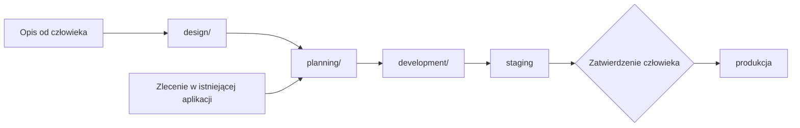

# Standardy tworzenia aplikacji przez agentów AI

Wersja zestawu: 1.4.0  
Data: 2026-11-09

Zestaw zasad, według których agent AI projektuje, planuje, buduje, wdraża i utrzymuje aplikacje webowe. Celem jest proces, w którym człowiek mówi, **co** ma powstać, a agent sam decyduje, **jak** to zrobić. Udział człowieka ogranicza się do analizy produktu, wyglądu, kosztów i zatwierdzenia wdrożenia na produkcję.

## Scenariusze

| Scenariusz | Przebieg |
|---|---|
| **Nowa aplikacja** | `design/` → `planning/` → `development/` |
| **Nowe zlecenie w istniejącej aplikacji**, np. „nowa bramka płatności w Wallet” | `planning/` → `development/`. Przez `design/` tylko wtedy, gdy zlecenie wymaga nowego obszaru produktu bez wzorca |
| **Pierwsza praca z istniejącą aplikacją** | `planning/input-readiness.md`: jednorazowa inwentaryzacja i przeniesienie dokumentacji do układu standardów, potem jak nowe zlecenie |

## Pliki

### `design/`: nowa aplikacja lub nowy obszar produktu

| Plik | Co ustala |
|---|---|
| [`discovery.md`](design/discovery.md) | Analiza produktu: cel, użytkownicy, role, reguły biznesowe, zakres pierwszej wersji, format dokumentacji produktu |
| [`ux-ui.md`](design/ux-ui.md) | Styl, logo, przepływy, makiety, design system |
| [`technology.md`](design/technology.md) | Stack, architektura, model danych, kontrakt API, usługi zewnętrzne, koszty |
| [`project-setup.md`](design/project-setup.md) | Repozytorium, ustawienia GitHub, konto agenta, kopia standardów w projekcie |

### `planning/`: od materiałów do zadań

| Plik | Co ustala |
|---|---|
| [`input-readiness.md`](planning/input-readiness.md) | Bramka wejścia: komplet materiałów, inwentaryzacja istniejącego projektu, typowe braki, jedno pytanie z brakami |
| [`task-planning.md`](planning/task-planning.md) | Iteracje, podział na zadania, priorytety, szablon zadania, statusy, definicja zadania kompletnego |

### `development/`: od zadania do produkcji

| Plik | Co ustala |
|---|---|
| [`task-workflow.md`](development/task-workflow.md) | Realizacja zadania: źródła decyzji, kiedy pytać, problemy poza zakresem, raport |
| [`code-standards.md`](development/code-standards.md) | Styl, nazewnictwo, typy, struktura, obsługa błędów, zależności |
| [`quality-checks.md`](development/quality-checks.md) | Testy, pokrycie, analiza statyczna, weryfikacja działania |
| [`security.md`](development/security.md) | Sekrety, walidacja, uwierzytelnianie, uprawnienia, dane osobowe |
| [`backend.md`](development/backend.md) | API, baza danych i migracje, cache, zadania w tle, integracje, logi |
| [`frontend.md`](development/frontend.md) | Spójność wyglądu, mobile first, dostępność, formularze, SEO, wydajność |
| [`ai.md`](development/ai.md) | AI w aplikacji: modele językowe (dostawca, izolacja, dane, koszty, bezpieczeństwo, ewaluacje) i własne modele ML |
| [`documentation.md`](development/documentation.md) | README, dokumentacja API, decyzje, `AGENTS.md` z profilem technicznym, podział dokumentacji |
| [`git-workflow.md`](development/git-workflow.md) | Commity, branche, PR, integracja, autonomia agenta w Git |
| [`code-review.md`](development/code-review.md) | Niezależny przegląd przez subagenta, uwagi, spory, werdykt |
| [`devops.md`](development/devops.md) | Środowisko lokalne, Docker, CI, przenośność, aktualizacje zależności |
| [`deployment.md`](development/deployment.md) | Wdrożenia, powrót do poprzedniej wersji, kopie zapasowe, monitoring, awarie |

## Gdzie uczestniczy człowiek

| Moment | Co robi człowiek |
|---|---|
| Analiza produktu | Opisuje produkt, odpowiada na rundy pytań, ustala granicę pierwszej wersji |
| Projektowanie wyglądu | Opisuje styl, wybiera kierunek, akceptuje makiety |
| Dobór technologii | Zatwierdza płatnych dostawców i koszty |
| Założenie projektu | Jednorazowo zakłada konto agenta; zatwierdza uruchomienie skryptu ustawień |
| Bramka wejścia | Odpowiada na braki blokujące, jeśli są |
| Gotowość do wdrożenia | Ogląda zmiany na stagingu i zatwierdza wdrożenie na produkcję |
| Wyjątki | Istotna decyzja produktowa nieprzewidziana wcześniej, problem nierozwiązany po 3 próbach, wyciek sekretu, odtworzenie bazy z kopii |

## Zasady całego zestawu

- **Zasady są domyślne.** Opis projektu, instrukcja współpracy lub polecenie użytkownika mogą je nadpisać. Nadpisania projektu są zapisane w `AGENTS.md`.
- **Pierwszeństwo przy konflikcie:** polecenie użytkownika, zadanie, instrukcje projektu, standardy. Przy konflikcie między standardami wygrywa rozwiązanie bezpieczniejsze dla danych i użytkowników.
- **Każdy plik jest samodzielny,** a każda zasada jest opisana w jednym miejscu.
- **Standardy w projekcie:** przy zakładaniu projektu zestaw jest kopiowany do `docs/standards/` w repozytorium. Agent stosuje kopię z projektu. Aktualizacja kopii to osobne zadanie.

## Jak zacząć

Przykładowe polecenia dla agenta:

| Scenariusz | Polecenie |
|---|---|
| Nowa aplikacja | „Stosując standardy z `~/Documents/AI/app-standards`, zaprojektuj i zbuduj aplikację według opisu: …” |
| Pierwsza praca z istniejącą aplikacją | „Stosując standardy z `~/Documents/AI/app-standards`, wykonaj inwentaryzację tego projektu i skopiuj standardy do `docs/standards/`.” |
| Nowe zlecenie | „Zlecenie: … Postępuj według standardów projektu.” |

## Wersje

- Każdy plik ma własny numer wersji w nagłówku.
- Wersja zestawu w tym pliku rośnie przy każdej zmianie któregokolwiek pliku. Kopia w projekcie zapisuje wersję zestawu, z której pochodzi.
- Historii zmian nie prowadzimy osobno.
