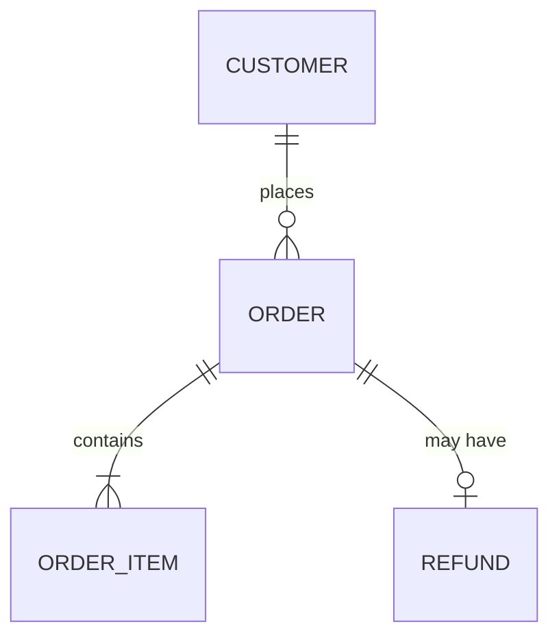

# Standard doboru technologii i architektury dla agentów AI

Wersja: 1.0.0  
Data: 2026-11-09

## Zakres i stosowanie

Stosuj ten standard po analizie produktu i projektowaniu wyglądu, przed założeniem projektu. Dokument określa, jak dobrać stack technologiczny, architekturę, panel administracyjny, model danych, kontrakt API i usługi zewnętrzne oraz jak zapisać te decyzje.

Wszystkie zasady są domyślne. Opis projektu, instrukcja współpracy lub polecenie użytkownika mogą je nadpisać; wtedy stosuj nadpisanie w jego zakresie.

Stosuj wersję dołączoną do projektu. Nie pobieraj automatycznie nowszej wersji ani nie zmieniaj tego standardu podczas realizacji zadania. Konflikt zasad rozstrzygaj według pierwszeństwa: polecenie użytkownika, zadanie, instrukcje projektu, standardy. Przy konflikcie między standardami wybierz rozwiązanie bezpieczniejsze dla danych i użytkowników, a rozstrzygnięcie opisz w raporcie.

## Zasady nadrzędne

- **Domyślny stack, chyba że inny jest wyraźnie lepszy.** Stosuj stack domyślny. Inny wybierz tylko wtedy, gdy lepiej spełnia potrzeby projektu, i zapisz uzasadnienie.
- **Najprostsza architektura, która spełnia potrzeby.** Złożoność dodawaj dopiero wtedy, gdy wymaga jej projekt.
- **Uznane rozwiązania zamiast własnych.** Korzystaj z uznanych bibliotek, narzędzi frameworka i usług zewnętrznych zamiast budować własne odpowiedniki.
- **Decyzje techniczne podejmuje agent.** Użytkownik decyduje tylko o kosztach i wyborze płatnych dostawców.

## Wejście

- Dokumentacja produktu: obszary, role, reguły, zakres pierwszej wersji, ograniczenia.
- Materiały projektu wyglądu: przepływy, makiety, design system.

## Stack domyślny

| Warstwa | Domyślnie |
|---|---|
| Backend | Python z FastAPI oraz uznanymi bibliotekami ekosystemu, np. Pydantic, SQLAlchemy, Alembic |
| Frontend | React z TypeScript |
| Strony publiczne | Framework z renderowaniem po stronie serwera lub statycznym, zgodny z React, np. Next.js lub Astro z komponentami React |
| Baza danych | PostgreSQL |
| Cache i kolejki | Redis lub Valkey |
| Panel administracyjny | Panel generowany narzędziem ekosystemu backendu, np. SQLAdmin dla FastAPI |

Wersje języków, frameworków i narzędzi dobieraj według standardu pisania kodu.

### Kiedy odstąpić od stacku domyślnego

Wybierz inną technologię, gdy daje wyraźną przewagę dla projektu, np.:

- funkcja główna wymaga ekosystemu, którego stack domyślny nie ma w dojrzałej postaci;
- aplikacja jest głównie serwisem treści, dla którego istnieje uznany system zarządzania treścią;
- klient lub istniejąca infrastruktura wymaga konkretnej technologii.

Odstępstwo zapisz jako decyzję w `docs/decisions/`: kontekst, rozważane warianty, wybór i konsekwencje. Sama preferencja agenta nie jest powodem odstępstwa.

## Architektura

- Domyślnie stosuj **modularny monolit**: jedną aplikację backendową podzieloną na moduły odpowiadające obszarom z dokumentacji produktu, np. `orders`, `payments`.
- Moduły komunikują się przez jawne interfejsy. Moduł nie sięga bezpośrednio do danych innego modułu.
- Nie stosuj mikroserwisów, chyba że projekt wymaga niezależnego skalowania lub wdrażania części systemu i zapisano to jako decyzję.
- Zadania w tle działają jako osobny proces z tego samego kodu aplikacji.
- Repozytorium jest monorepo z przestrzeniami, np. `api/` dla backendu, `client/` dla frontendu klienta, `admin/` dla osobnego panelu administracyjnego, jeśli powstaje. Twórz tylko przestrzenie potrzebne projektowi.

## Panel administracyjny

- **Mały i średni projekt:** panel generowany narzędziem ekosystemu backendu, z obsługą danych i uprawnień administracyjnych. Bez osobnej aplikacji frontendowej.
- **Duży projekt lub rozbudowane procesy administracyjne,** np. wieloetapowa obsługa zgłoszeń, raporty, praca wielu zespołów: osobna aplikacja w przestrzeni `admin/`, zbudowana tym samym stackiem co frontend klienta.
- Panel administracyjny podlega tym samym zasadom bezpieczeństwa i uprawnień co reszta aplikacji.

## Aplikacja mobilna

- Gdy projekt potrzebuje obsługi na telefonie, domyślnie buduj aplikację webową mobile first.
- Jeśli użytkownicy mają korzystać z aplikacji jak z zainstalowanej, dodaj obsługę PWA: manifest, ikony, możliwość dodania do ekranu telefonu.
- Aplikację natywną planuj tylko wtedy, gdy opis projektu jej wymaga, np. dostęp do funkcji urządzenia niedostępnych w przeglądarce albo publikacja w sklepach z aplikacjami.

## Model danych

- Wyprowadź model danych z dokumentacji produktu: obiektów ze słownika pojęć, reguł biznesowych i statusów.
- Nazwy encji i pól pochodzą z kolumny nazw w kodzie słownika pojęć.
- Stosuj zasady standardu backendu dotyczące bazy danych, np. typy dla czasu i kwot, więzy integralności.
- Zapisz model jako diagram ERD w Mermaid w `docs/architecture.md`. Ten sam plik zawiera później mapę kodu.

## Kontrakt API

- Kontrakt API powstaje przed kodem (contract-first). Przygotuj specyfikację OpenAPI w `docs/api/openapi.yaml` na podstawie scenariuszy i reguł z dokumentacji produktu.
- Specyfikacja stosuje zasady standardu backendu: styl API, wersję w ścieżce, format błędów, paginację, idempotencję.
- Każdy punkt końcowy ma modele żądania i odpowiedzi, odpowiedzi błędów i przykłady.
- Development buduje API według kontraktu. CI sprawdza, czy specyfikacja wygenerowana z kodu jest zgodna z kontraktem.
- Frontend generuje typy i klienta API z kontraktu, więc frontend i backend mogą powstawać równolegle.

## Usługi zewnętrzne

- Dla każdej potrzeby, którą lepiej rozwiązuje usługa zewnętrzna, np. płatności, wysyłka e-maili, SMS, mapy, przygotuj porównanie 2–3 uznanych dostawców:
  - koszt przy przewidywanej skali;
  - potrzebne funkcje i ograniczenia;
  - lokalizacja przetwarzania danych i zgodność z RODO;
  - dostępność środowiska testowego (sandbox);
  - jakość oficjalnej biblioteki lub API.
- Przedstaw rekomendację. Wybór dostawcy należy do użytkownika, bo dotyczy kosztów i umowy.

## Bezpieczeństwo w architekturze

- Wskaż dane osobowe i dane wrażliwe, które aplikacja przetwarza, oraz moduły, które je przechowują.
- Wskaż przepływy podwyższonego ryzyka, np. płatności, uprawnienia, integracje, i sposób ich zabezpieczenia według standardu bezpieczeństwa.
- Zapisz te informacje w `docs/architecture.md`.

## Koszty

Przygotuj szacunek miesięcznych kosztów pierwszej wersji: hosting, baza danych, kopie zapasowe, usługi zewnętrzne, monitoring. Podaj wariant przy starcie i przy przewidywanym wzroście.

## Wynik

- Decyzje o stacku i każdym odstępstwie od domyślnych rozwiązań zapisane w `docs/decisions/`.
- `docs/architecture.md` z modułami, modelem danych i danymi wrażliwymi.
- `docs/api/openapi.yaml` z kontraktem API.
- Treść profilu technicznego, który przy zakładaniu projektu trafia do pliku instrukcji dla agentów, np. `AGENTS.md`.
- Jedna strona podsumowania dla użytkownika: stack, architektura, usługi zewnętrzne z rekomendacją, koszty miesięczne. Użytkownik zatwierdza wybór płatnych dostawców i koszty.

## Kryteria zakończenia

- Zastosowano stack domyślny albo odstępstwo jest uzasadnione i zapisane.
- Architektura to modularny monolit z modułami odpowiadającymi obszarom produktu, chyba że zapisano inną decyzję.
- Panel administracyjny i obsługa telefonu dobrane są do wielkości i potrzeb projektu.
- Model danych wynika ze słownika pojęć i reguł, zapisany jako ERD.
- Kontrakt API jest kompletny, zgodny ze standardem backendu i zapisany przed rozpoczęciem developmentu.
- Dla usług zewnętrznych przygotowano porównanie dostawców; użytkownik zatwierdził wybór i koszty.
- Dane wrażliwe i przepływy podwyższonego ryzyka są wskazane.
- Profil techniczny jest gotowy do zapisania przy zakładaniu projektu.
